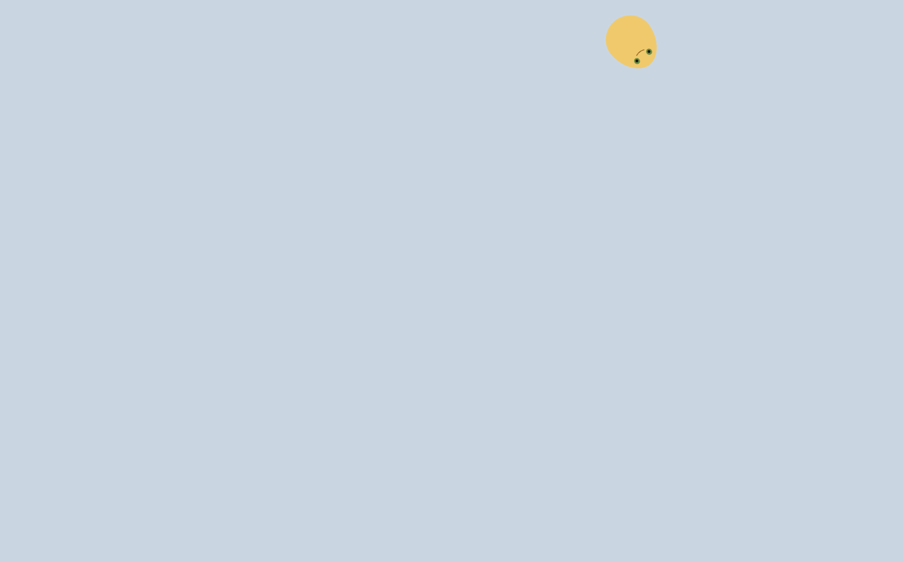
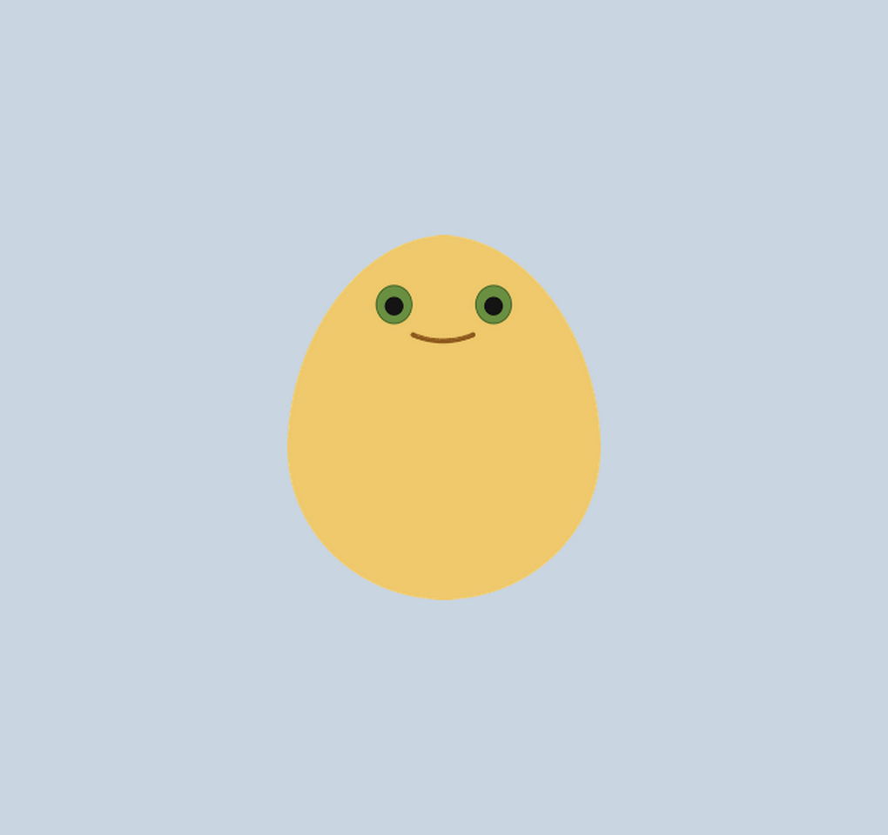
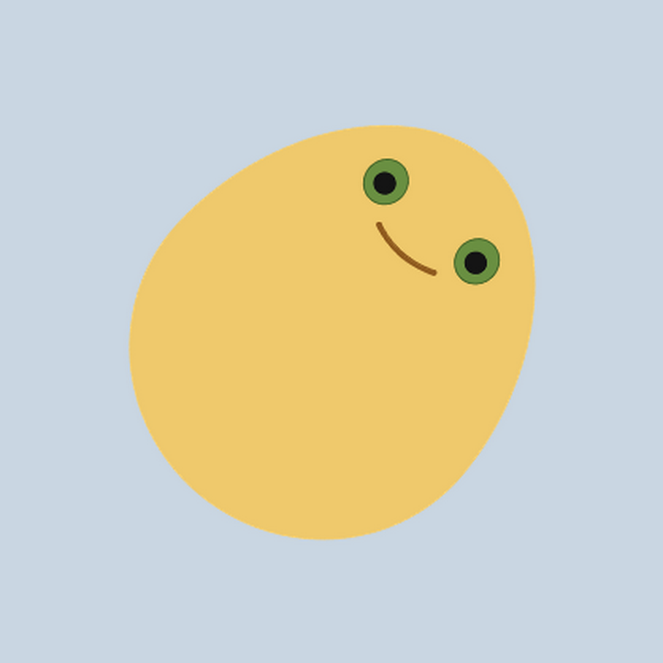
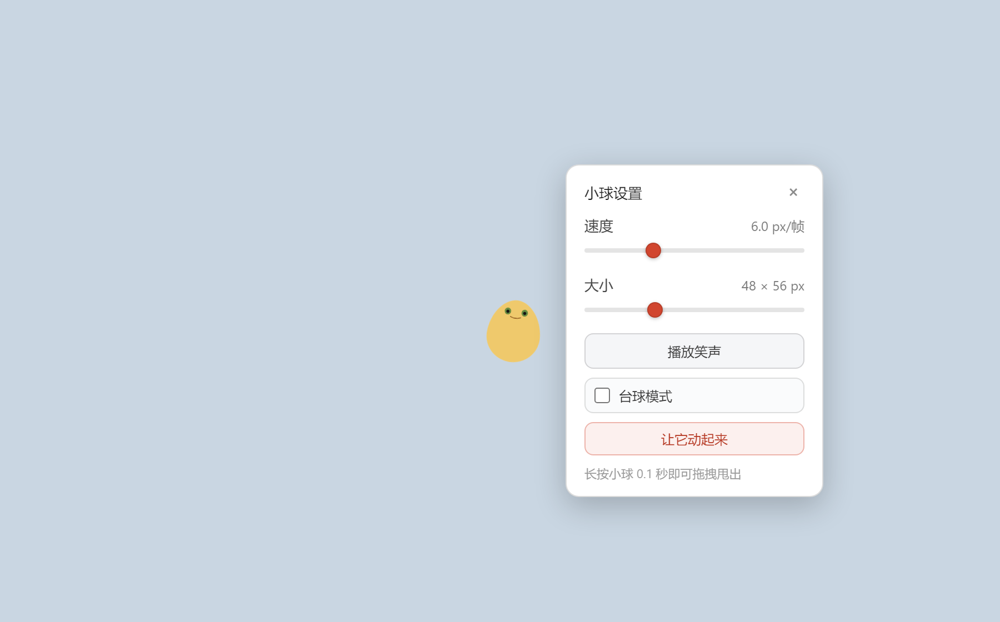
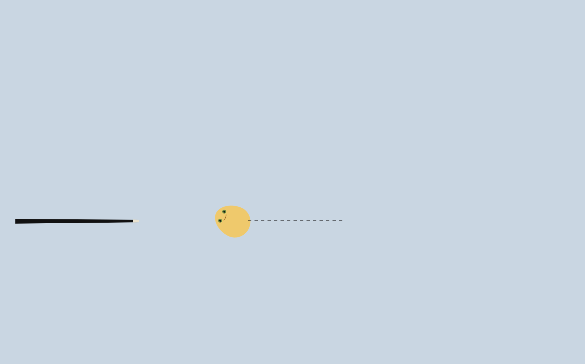
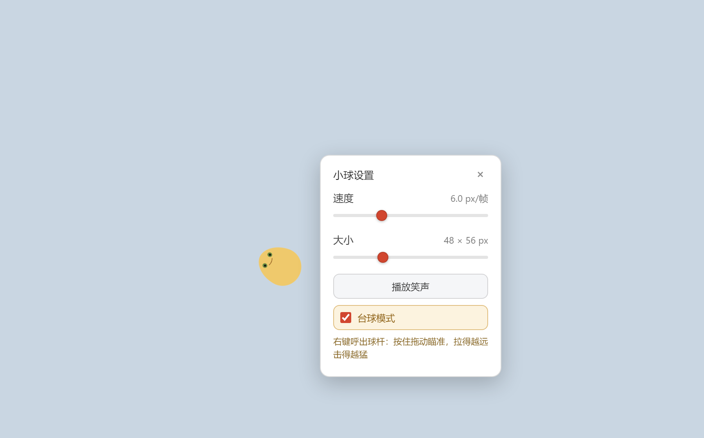
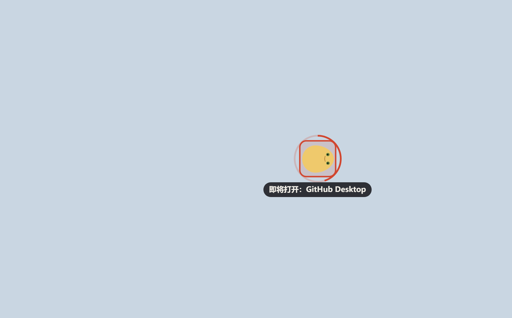
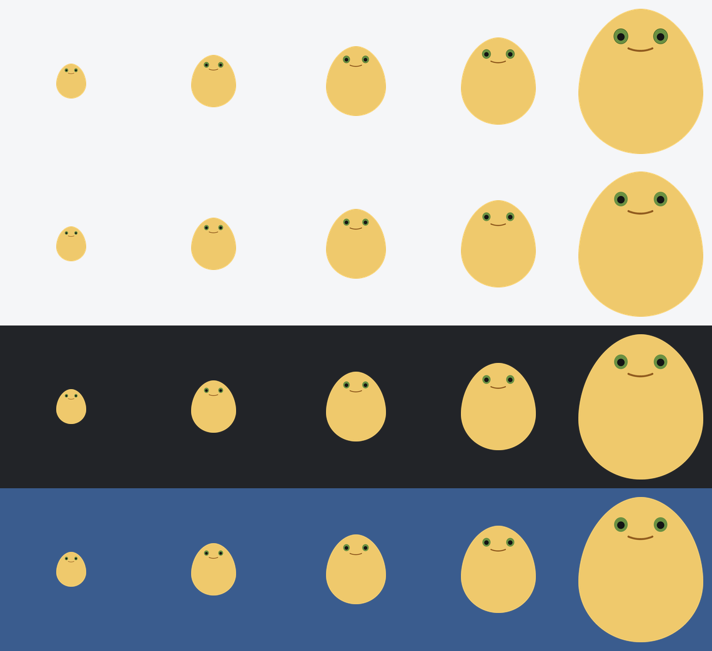

# 奶球 · DesktopBall

Electron + TypeScript 写的 Windows 桌面挂件：一块**全屏透明、置顶、平时鼠标穿透**的画布上养着一颗蛋形小球。
小球是一张**平面化贴图**（黄色蛋身 + 绿色眼睛 + 一道弧线嘴巴），默认 48 × 56 px、无外发光；
**移动时会像陀螺一样自转**，碰壁随机反弹，点一下它会停下来并弹出设置面板，长按才能拖拽甩出去。
面板里还能勾上**台球模式**：小球停下不动，改用右键呼出球杆，拉得越远打得越狠。
台球模式下还附带一个小玩法：小球滚到哪个**桌面图标**上停稳，那个图标就会被框住并倒数 1.5 秒，
然后帮你把它打开 —— 动一下鼠标就取消。


> **快速跳转**：[功能一览](#功能一览) · [安装](#安装) · [操作说明](#效果--交互) ·
> [目录结构](#目录结构) · [常见问题](#常见问题)







上面这张是**抛出去之后抓拍的一帧**：蛋身、眼睛、嘴巴一起倾斜 ——
旋转作用在整张贴图上，不是各画各的。





按住右键拖动指针，球杆会**绕着球转 + 前后拉**；松手球杆就朝球冲过去。
上图是拉杆量 96px（约八成力）时的一帧：黑色杆身 + 浅色皮头在球的左后方，虚线是瞄准方向。





上面这张是**停稳之后、倒计时走到一半**的一帧：红色圆角框圈住脚下的图标，
外圈那道环是倒计时（画满就启动），下面挂着要打开的应用名。
框和球一样大（都是 48px），所以球正好卡在框里 —— 真实桌面上图标就在那个位置。

## 功能一览

一只养在桌面上的蛋形小球，加上一套「把它当玩具」的玩法：

- **会自己动的宠物** —— 空闲时匀速直线飞，碰到屏幕四边按法线**随机偏转 ±26°** 反弹，轨迹不会来回重复。
- **移动时自转** —— 贴图按「滚动」关系旋转：向右飞顺时针、向左飞逆时针，停下就不转；撞到左右墙方向自然反过来。
- **可拖可抛** —— **长按 0.1s** 进入拖拽，拖着走；松手时按拖拽速度甩出去，最高 25 px/帧，然后指数衰减回常态。
- **点一下开面板** —— **单击**小球停下并弹出设置面板，两个滑块调**速度**和**大小**，还能放笑声。
- **播放笑声** —— 面板里一键播放你自己放进来的音频，播放中按钮变成「停止大笑」。
- **鼠标穿透** —— 平时整块画布对鼠标完全透明，桌面该怎么点就怎么点；只有鼠标移到球或面板上时才接管。
- **台球模式** —— 勾上后小球静止，**右键**呼出球杆，拖着指针绕着球转 + 前后拉，松手击球；球按库仑摩擦滑停。
- **停稳开应用** —— 台球模式下的彩蛋：小球滚到哪个**桌面图标**上停稳，就框住那个图标倒数 1.5 秒，然后帮你打开它；动一下鼠标即取消。
- **托盘常驻** —— 通知区域图标可右键：暂停 / 继续、重置小球、重新贴合主屏、退出。暂停时倒计时也会一起冻住。

## 安装

### 系统要求

| 项目 | 要求 |
| --- | --- |
| 系统 | **Windows 10 / 11（64 位）** |
| Node.js | **不需要** —— 安装包自带运行时 |
| 权限 | 普通用户即可，**不需要管理员** |
| 磁盘 | 安装后约 **270 MB**；下载的安装包只有 **77 MB**（LZMA 压缩，里面主要是 Chromium） |

> **为什么不支持 macOS / Linux？** 这个项目重度依赖 Win32 专有机制：透明分层窗口、
> `screen.screenToDipRect` 的多显示器换算，以及用 koffi 跨进程读 `SysListView32`
> 拿桌面图标位置（「停稳开应用」靠它）。这些在别的系统上没有等价物。

### 方式一：下载安装包（推荐）

到 **[Releases](https://github.com/xuanleil28-web/naiqiu/releases)** 页面下载：

| 文件 | 怎么用 |
| --- | --- |
| `naiqiu-1.0.0-x64-setup.exe` | **安装版。** 双击 → 一路「下一步」。会创建桌面和开始菜单快捷方式，可以从「设置 → 应用」里正常卸载 |
| `naiqiu-1.0.0-portable.exe` | **免安装版。** 双击直接跑，不写注册表；换台电脑拷走就能用 |

> **首次运行弹「Windows 已保护你的电脑」怎么办？**
> 点 **「更多信息」→「仍要运行」**。这是 Windows Defender SmartScreen 对所有
> **没有买代码签名证书**的个人应用的标准提示，不是报错、也不代表程序有问题
> （一份代码签名证书一年要几百美元，个人项目基本都不会买）。
> 不放心的话就按下面的方式二自己从源码构建。

**装好之后球在哪？** 双击快捷方式启动，球会出现在屏幕上——注意三点：

1. 程序**不会在任务栏留按钮**。这是刻意的：全屏透明置顶窗如果占任务栏，会永远挂着一条多余的条。
2. 所以要找它，看屏幕右下角的**通知区域（托盘）**。
3. Windows 11 默认会把新图标收进 `^` **溢出面板** —— 点开 `^`，把奶球**拖到任务栏上**就固定住了。
   之后右键托盘图标能暂停 / 重置 / 退出。

**怎么退出？** 右键托盘图标 → **退出**。面板里没有退出按钮，因为它是给日常玩用的。

### 方式二：从源码构建

装了 Node.js 18+ 之后：

```bash
git clone https://github.com/xuanleil28-web/naiqiu.git
cd naiqiu
npm install
npm run dev        # 编译 + 直接运行（改完代码重跑一次即可）
```

想自己打一份安装包：

```bash
npm run dist       # 产物在 release/1.0.0/
```

两个可能踩到的坑：

- **`npm install` 卡在下载 Electron** —— 仓库里带了一个 `.npmrc`，已经把
  Electron 二进制指向 npmmirror。**如果你能直连 GitHub，删掉 `.npmrc` 会更快。**
- **打包报 `Cannot create symbolic link ...`** —— 打开 Windows「设置 → 系统 → 开发者模式」
  再重跑，或者以管理员身份运行终端。**这是 `electron-builder` 自己的问题，跟本项目无关**；
  没有管理员权限时还有一套绕行办法，见下面[常见问题](#常见问题)里的同名条目。

### 卸载

- **安装版**：Windows「设置 → 应用」里搜**奶球**卸载，或运行安装目录下的 `Uninstall 奶球.exe`。
- **免安装版**：直接删掉那个 exe 就行。
- **不留残余**：程序本身**不写任何配置文件**（面板里的速度和大小只在内存里，重启回到默认），
  安装版卸载时连 Electron 的缓存目录也会一并清掉。

## 效果 / 交互

| 操作 | 行为 |
| --- | --- |
| 空闲 | 小球匀速直线运动，碰四边反弹；**反弹方向在法线基础上随机偏转 ±26°**，轨迹不会来回重复 |
| **移动时** | 贴图按「滚动」关系自转：角速度正比于**水平**速度，向右飞顺时针、向左飞逆时针；撞左右墙后方向自然跟着反过来，停下就不转 |
| 甩出之后 | 起步速度最高 25 px/帧，然后按指数衰减，约 4s 回到常态速度（默认 6 px/帧） |
| **单击小球** | 小球停下 + 弹出设置面板（速度 / 大小两个滑块）；再点一次收起 |
| **播放笑声** | 面板里的按钮，点了就放你自己放的音频文件。**播放中按钮变成「停止大笑」，再点就停** |
| **长按小球 0.1s** | 进入拖拽，可以拖着走；松手时按拖拽速度抛出 |
| 短按后移动了 | 本次按压作废：不拖拽、不弹面板，小球带着原速度继续飞 |
| 鼠标移入小球 / 面板 | 自动关闭鼠标穿透（主进程 `setIgnoreMouseEvents(false)`） |
| 鼠标移开 | 自动恢复穿透，桌面照常点得动 |
| 拖拽中 | 小球严格限制在屏幕内，拖不出界 |
| 托盘右键 | **暂停 / 继续**、重置小球、重新贴合主屏、**退出** |

### 台球模式

面板里勾上**台球模式**之后，玩法整体换一套：

| 操作 | 行为 |
| --- | --- |
| 勾上的瞬间 | 小球**立刻静止**，之后不会再自己动；把「让它动起来」按钮和拖动提示一并收起 |
| **单击左键** | 只负责开 / 关面板 —— **拖不动球**（长按也不行） |
| **单击右键** | 呼出球杆：球杆出现在指针那一侧，杆头正对着指针位置，瞄准虚线从球面沿击球方向指出去 |
| **按住右键拖动** | 球杆跟着指针走：**绕着球转**（改方向）+ **前后拉**（改力度） |
| **松开右键** | 球杆沿轴向前冲。杆头在 90ms 内追上球面，**那一刻才算击中** |
| 击中 | 小球拿到初速度飞出；方向就是杆轴方向，速率 = `3 + 拉杆量/120 × 22`（拉杆量超过 120 按 120 算） |
| 拉杆量 < 8px | 当作没拉（右键原地一点的情况）→ 球杆直接收走，不击球 |
| 球飞出去之后 | 按**恒定减速度**（库仑摩擦，0.15 px/帧²）慢慢停下来，途中照样碰边反弹 + 滚动自转 |
| 球在冲杆的 90ms 里滚开了 | 杆头扑空 —— **这一杆就是空杆**，不会隔空补一下 |
| 取消勾选 | 小球重新以常态速度跑起来，左键拖拽恢复，右键退回去当普通右键用 |

> 满力一杆约 25 px/帧 击出、滚两千多像素、2.8s 停下；轻轻一推只走百来像素。
> 撞到边界时走的是**正常模式那套随机偏航反弹**（同一份 `bounce()` 代码），
> 所以台球模式下的边界行为跟平时完全一致。

**拉杆量 → 初速度的对应关系**（线性，满力 120px）：

| 拉杆量 | 指针离球心 | 初速度 | 手感 |
| --- | --- | --- | --- |
| 8px（下限） | 32px | 4.5 px/帧 | 轻轻一碰，走百来像素 |
| 16px | 40px | 5.9 px/帧 | 差不多是常态速度 |
| 48px | 72px | 11.8 px/帧 | 中等力度 |
| 96px | 120px | 20.6 px/帧 | 大力度 |
| **120px（满力）** | **144px** | **25 px/帧** | 破防一杆，拉过头也是这个速度 |

每拉 1px ≈ 加 0.18 px/帧。分母就是 `CUE_MAX_PULL`，所以**改那一个常量整条曲线会自己重新对齐**
（拉距变短 → 灵敏度等比变高，满力永远落在被钳住的那一点上）。

### 停稳开应用（只在台球模式下）

台球模式下小球**滚着滚着停住**，如果它停下来的位置正好压着一个桌面图标，就会：

```
停稳 ──▶ 读一次桌面图标 ──▶ 命中谁就高亮谁 ──▶ 1.5s 倒计时环 ──▶ 打开它
                            （框 + 环 + 名字牌）        ↑
                                          这一秒半里动一下鼠标 = 取消
```

| 环节 | 行为 |
| --- | --- |
| 触发前提 | 勾着**台球模式**，并且这一杆是**球杆打出去**的。刚进模式、托盘重置、重新贴合主屏都不会触发 |
| 停稳那一刻 | 才去读桌面图标（一次 6~15ms）。这几毫秒里球要是又动了，这一次就作废 |
| 高亮 | 红色圆角框 + 外圈倒计时环 + 下方「即将打开：×××」名字牌；环从正上方顺时针画满 |
| 1.5 秒 | 环画满就启动。**倒计时期间鼠标移动超过 3px 立刻取消**，什么都不发生 |
| 名字牌挂哪 | 默认挂在图标下方，下方装不下（贴着屏幕底边的图标）就翻到上方 |
| 其余取消路径 | 再打一杆、取消勾选台球模式、托盘「重置小球」、窗口尺寸变化（读到的坐标会失效）、托盘暂停（倒计时被冻住，恢复后接着走） |
| 读不到图标 | koffi 没装上 / 不是 Windows / explorer 异常 → **整个功能静默关闭**，球照常停，不报错、不弹窗 |
| 脚下没有图标 | 什么都不画。「读不到图标」和「脚下没图标」在界面上一视同仁 —— 都是不高亮 |

**只认「桌面上真实存在的启动项」**，命中判定是这样收窄的：

- 只认桌面文件夹（当前用户的 `Desktop` + 公共 `Desktop`）里真的有的条目；
- 扩展名只认 `.lnk` / `.url` / `.exe` / `.bat` / `.cmd`，外加文件夹本身；
- **「回收站」「此电脑」这类虚拟图标会被自动跳过** —— 它们在 `SysListView32` 里有名字、有坐标，
  但在文件系统里根本没有对应文件，冒然 `shell.openPath` 只会失败。所以判据必须是
  「桌面上真有这个文件」，**不能靠名字是否为空**（实测 54 个图标里一个空名字都没有，包括回收站）。

> **图标尺寸是量出来的，不是写死的。** 用户可以 Ctrl+滚轮把图标调大调小（Windows 允许连续
> 缩放，不限于小 / 中 / 大那三档），所以代码不假设任何尺寸：先用 `LVM_GETITEMPOSITION`
> 拿到图标图案的左上角，再用 `LVM_GETITEMRECT(LVIR_ICON)` 拿到整列宽度，因为图标在列里
> 是水平居中的，于是 `边长 = 列宽 − 2 × 左内边距`。测这台机器时正中间量到过一次
> 150 − 2×27 = 96 物理像素（48 DIP，Windows「中等图标」），后来把图标调大后同一台机器
> 就变成 150 − 2×21 = 108 物理像素（54 DIP）—— **同一个公式，两次都对，`npm run probe-icons`
> 会把当前值打出来**。代码里一个像素值都没写死。

> **`.lnk` / `.url` 的扩展名在资源管理器里永远不显示**（就算关掉「隐藏已知扩展名」也是），
> 而 `.exe` 的会显示。所以查表时**文件名和去掉扩展名的主干都登记**，两条路都能命中。
> 这条是实测出来的：一开始只登记主干，54 个图标里 6 个 `.exe` 全都算不上；补上之后 53/54 可启动。

### 设置面板

- **速度**滑块（0~20 px/帧，步长 0.5）：改的是「常态速度」，也就是抛出后回落的目标。
  小球停着的时候拖动它，会立刻带着小球跑起来（滑块要有即时反馈）。
- **大小**滑块（水平半径 8~60px，步长 1）：实时改尺寸，数值按「宽 × 高」显示
  （贴图是蛋形、比圆高，宽高比 ≈ 1.163）。改大后会自动收回屏幕内。
- 「让它动起来」按钮：只在小球停着时出现 —— 因为单击会把球停下，
  没这个按钮就找不到重新启动的入口了。
- **「播放笑声」按钮**：放你自己准备的音频。**这是个开关** ——
  点一下开始播、按钮变成「停止大笑」；再点一下就停，并把进度拨回开头（下次点是从头播）。
  音频自然播完时按钮也会自己变回「播放笑声」。
- **「台球模式」勾选项**：整行都能点。勾上后整行点亮，下面多出一句玩法说明，
  底部那句「长按拖拽」的提示和「让它动起来」按钮收起（那两样在台球模式下都不成立）。
- 面板只在自己和球身上接管鼠标事件，**指针一离开就恢复穿透**，不会把整个桌面挡住。
  （唯一例外：勾上台球模式后，球心周围 240px 也要接管，否则全屏穿透的窗口根本收不到右键。）

### 笑声按钮的音频放哪

**把音频文件放到 `src/renderer/` 目录下，命名为 `laugh.mp3`**，然后重新构建一次：

```bash
# 1) 放文件（文件名必须叫 laugh.*，扩展名认这几个）
#    src/renderer/laugh.mp3   ← 首选
#    src/renderer/laugh.wav
#    src/renderer/laugh.ogg
#    src/renderer/laugh.m4a

# 2) 重新构建（会自动把它拷进 dist/renderer）
npm run build      # 或者直接 npm run dev / npm run shot

# 3) 想要确认被认出来了
node scripts/boot-check.js
#   → ✓ 笑声音频已就绪（laugh.mp3）
```

几点说明：

- **格式**：`.mp3` / `.wav` / `.ogg` / `.m4a` 都行，代码会按这个顺序挨个探测，
  **你先放哪个就用哪个**，不用改代码。所以丢一个 `laugh.wav` 进去也能直接跑。
- **别同时放两个**：如果 `laugh.mp3` 和 `laugh.wav` 都在，永远只会用顺序靠前的 `laugh.mp3`。
- **没放文件也不会出错**：构建照常成功，按钮点了会显示一行红字说明该把文件放哪，
  控制台里也会打一条同样的提示。**不静默失灵**，这是刻意做的。
- **不用管拷贝**：`scripts/build.js` 会自动把 `src/renderer/laugh.*` 拷进 `dist/renderer/`，
  和 `ball-sprite.png` 一个待遇。直接改 `dist/` 里的文件是没用的 —— 下次构建会被冲掉。
- **音量**：跟系统音量走，应用本身不做任何调节。

> 小球整张是贴图，**不画任何外发光 / 光圈，也没有额外描边和高光**。
> 单击**不再改变颜色**，反馈就只有「停下 + 缩放脉冲 + 弹出面板」这三样。
> 至于「有没有抓住」：按压期间小球会原地冻结、长按后完全跟手，动作本身就是反馈。


## 目录结构

```
desktop-ball/
├─ src/
│  ├─ main/main.ts         主进程：透明窗口、托盘、鼠标穿透 IPC、桌面图标 IPC
│  ├─ main/icons.ts        ★ 读桌面图标 + 启动指定图标（koffi FFI 调 Win32）
│  ├─ preload/preload.ts   contextBridge 暴露 window.ballAPI
│  └─ renderer/
│     ├─ renderer.ts       小球物理（含滚动自转）+ 拖拽/点击判定 + 台球模式 + 贴图绘制 + 笑声 + 停稳开应用
│     ├─ ball-sprite.png   ★ 小球贴图（448×521，由 gen_sprite.py 生成）
│     ├─ laugh.mp3         ☆ 可选：笑声音频，自己放（也认 .wav / .ogg / .m4a）
│     ├─ index.html
│     └─ style.css
├─ scripts/
│  ├─ build.js             clean → tsc ×2 → 拷贝静态资源（含贴图 + 可选的笑声音频）
│  ├─ clean.js
│  ├─ gen_icons.py         应用 / 窗口 / 托盘图标（复用 gen_sprite 的角色，原生分辨率渲染）
│  ├─ gen_sprite.py        ★ 把原图平面化成 ball-sprite.png（Pillow）
│  ├─ smoke-test.js        无头冒烟测试（桩 DOM + vm 跑真实渲染逻辑，177 项断言）
│  ├─ boot-check.js        启动自检（真拉一次 Electron 看日志）
│  ├─ probe-desktop-icons.cjs  ★ 桌面图标读取诊断：11 步自检 + 落一份 JSON 报告
│  ├─ screenshot.js        视觉验证：自动点小球 / 勾台球模式 / 拉杆 / 停到图标上，截 7 张图到 docs/
├─ docs/*.png              README 里的效果图（小球 / 面板 / 贴图特写 / 旋转特写 / 球杆 / 倒计时 / 贴图预览）
├─ build/icon.png          electron-builder 的图标源（512×512，自动转 .ico）
├─ assets/app.png          运行时窗口图标（256×256）
├─ assets/tray.png         托盘图标（32×32）
├─ LICENSE                 MIT 许可证
├─ README.md               本文件
├─ .npmrc                  Electron 二进制走 npmmirror，避免下载卡死
├─ tsconfig.json           编辑器用（noEmit）
├─ tsconfig.main.json      主进程 / preload → dist/
└─ tsconfig.renderer.json  渲染进程 → dist/renderer/
```

## 命令

```bash
npm install

npm run dev          # 编译 + 启动（最常用）
npm run dev:watch    # tsc 监听 + 自动拉起 electron，适合改渲染层
npm start            # 只启动（需先 build）

npm run typecheck    # 全量类型检查，不产出文件
npm run smoke        # 无头冒烟测试：用桩 DOM 跑真实渲染逻辑，177 项断言
npm run boot-check   # 启动自检：真拉一次 Electron，验证主进程/preload/首帧绘制
npm run probe-icons  # 桌面图标读取诊断：11 步自检 + 落一份 JSON 报告
npm run shot         # 视觉验证：自动点小球 / 勾台球模式 / 拉杆 / 停到图标上，截 7 张图存到 docs/
npm run pack         # 免安装目录版 → release/<version>/win-unpacked/
npm run dist         # 出包：NSIS 安装程序 + 免安装 exe → release/<version>/
```

> `npm install` 会下载 ~110MB 的 Electron 二进制，默认走 GitHub Releases，国内网络容易卡死。
> 仓库里的 `.npmrc` 已经把它指向 npmmirror（阿里官方镜像，同源官方产物）。
> 如果你能直连 GitHub，删掉 `.npmrc` 即可。

`npm run dist` 产物：

- `奶球-1.0.0-x64-setup.exe` —— NSIS 安装包，可选安装目录，自动建桌面快捷方式「奶球」
- `奶球-1.0.0-portable.exe` —— 绿色单文件版

## 三层职责与关键实现

### 主进程 `src/main/main.ts`

- 窗口选项：`transparent` + `frame:false` + `hasShadow:false` + `skipTaskbar:true` + `alwaysOnTop` + `focusable:false`
- 标题与图标：`title: '奶球'` + `icon: assets/app.png`（那颗黄色蛋形小生物）。
  打包后 Windows 一般直接用 exe 里嵌的图标，但 dev（跑的是 `node_modules` 里的 `electron.exe`）
  和免安装版得靠这一份，否则任务栏按钮 / Alt+Tab 会显示 Electron 的默认图标。
  图标文件缺失时返回 `undefined` 让 Electron 退回默认图标，**不抛错**（和托盘图标一个策略）
- 应用名由 `package.json` 顶层的 `productName` 决定（渲染进程读不到，也不该读），
  启动日志里会带一条 `name=奶球` 方便确认改名真的生效了
- 用 `screen.getPrimaryDisplay().workArea` 定位，**覆盖主屏工作区但不盖住任务栏**；监听 `display-metrics-changed / display-added / display-removed` 自动重新贴合
- `setAlwaysOnTop(true, 'screen-saver')` 拿到最高层级
- `showInactive()` 显示但**不抢焦点**，配合 `focusable:false` 做到打字、全屏游戏都不被打断
- 初始化即 `setIgnoreMouseEvents(true, { forward: true })`：穿透，但 `forward` 会把 `mousemove` 继续转发给渲染进程 —— 这是「鼠标悬停到小球上才恢复交互」能成立的前提
- IPC `set-interactive`：只接受主窗口的 `webContents`，`true` 恢复接收鼠标 / `false` 恢复穿透
- IPC `read-desktop-icons` → 读一次桌面图标（返回窗口内 DIP 坐标 + 能不能启动）
- IPC `launch-desktop-icon` → 按**名字**启动桌面上的一个图标
- 启动时打一条能力日志：`[main] 桌面图标启动：可用 / 不可用`
- 托盘：`暂停 ↔ 继续`、重置小球、重新贴合主屏、退出；左键单击直接弹菜单

### preload `src/preload/preload.ts`

- `contextIsolation: true` + `nodeIntegration: false`，渲染进程拿不到 `ipcRenderer` 本体
- `contextBridge.exposeInMainWorld('ballAPI', ...)`，只有 6 个白名单方法：
  `setInteractive(value)`、`readDesktopIcons()`、`launchDesktopIcon(name)` 和
  `onPaused / onReset / onLayoutChanged` 三个订阅（返回 `unsubscribe`，不会泄漏监听器）
- 渲染层里 `readDesktopIcons` / `launchDesktopIcon` 声明成**可选**成员：万一 `dist/preload` 是旧的
  （只重建了渲染层），缺一个方法不该把整个渲染进程搞崩 —— 拿不到就当没这个功能

### 桌面图标 `src/main/icons.ts`

「停稳开应用」的全部脏活都在这一个文件里。它做两件事：读出桌面上有哪些图标、各自在哪；
以及按名字启动其中一个。

**怎么拿到图标坐标** —— 这事比看起来麻烦得多：

1. 找窗口：`FindWindow('Progman')` → `FindWindowEx('SHELLDLL_DefView')` → `FindWindowEx('SysListView32')`。
   换过壁纸、按过 Win+D 之后 `DefView` 会被挂到 `WorkerW` 下面，所以要再扫一遍 `WorkerW` 兜底。
2. 列内容：`LVM_GETITEMCOUNT` / `LVM_GETITEMPOSITION` / `LVM_GETITEMRECT` / `LVM_GETITEMTEXTW`。
3. **但这几个 `LVM_*` 消息不会跨进程编组** —— 直接把 explorer 的窗口句柄拿来发消息，
   结果要么全 0、要么静默失败。所以必须自己开一段对方进程的内存，把结构体和文本缓冲区放进去：
   `OpenProcess` → `VirtualAllocEx` ×4 → `WriteProcessMemory` → `SendMessageW` →
   `ReadProcessMemory` → `VirtualFreeEx` → `CloseHandle`。整个流程包在 `try/finally` 里，
   任何一步失败都会把四块远程内存和句柄放干净。
4. `LVITEMW` 的布局没背下来，是用 `koffi.sizeof` / `koffi.offsetof` **自己量**出来的
   （x64 下 `sizeof = 88`，`pszText @24`、`cchTextMax @32`、`lParam @40`）——
   结构体跨版本对不上这种事，量一次比查十篇文档靠谱。
5. 坐标换算：图标位置是**物理像素**，画布是 DIP，所以用
   `screen.screenToDipRect(win, rect)` 换一次（它会按窗口所在那块显示器取缩放比，
   多显示器 / 混合 DPI 下才对），再减掉窗口原点。

**为什么是 koffi** —— 为了让别人 clone 下来就能跑：

- koffi 是纯 FFI 的 N-API 绑定，**预编译二进制**跟着 `optionalDependencies` 走
  （`@koromix/koffi-win32-x64` → `win32_x64/koffi.node`），装依赖时不需要 node-gyp、
  不需要 Visual Studio、不需要 Python。`electron-builder` 打包时会直接打印
  `• no native dependencies` 并且**不去 rebuild 它** —— 这条就是「开源之后别人也能用」的关键。
- `koffi.view()`（在远程内存上套一个 TypedArray）**在 Electron 里不能用** ——
  外部缓冲区在渲染/主进程会被拦掉。所以读远程内存一律走 `ReadProcessMemory`，别想着偷懒。
- koffi 里 `void *` 进出都是 **BigInt**（`SendMessageW` 的 `lParam`、handle 都是），
  `_Out_ uint32_t *` 传单元素数组，`_Out_ void *` 传 Node `Buffer`。
- 加载失败**不抛异常**：懒加载 + 兜一次 `console.warn`，`isIconLaunchSupported()` 直接返回 false，
  整个功能静默关闭。非 Windows 同理。

**启动这一步为什么只收名字**：渲染进程把「名字」报上来，主进程**自己**去桌面文件夹里查这个
名字对应哪个文件再 `shell.openPath`。路径永远不出渲染层 —— 否则被注入的渲染进程就能让主进程
打开任意文件。「回收站」这类虚拟图标也是靠这条查表自动出局的（文件系统里根本没有它）。

**打包配置**：`asarUnpack: ["assets/**", "**/*.node"]`。Electron 32 其实能从 asar 里加载
`.node`（幕后会解到临时目录，没写进文档的行为），但把一个原生模块压在 asar 里依赖这种未公开
行为、还容易踩杀软策略，不划算。
`npm run probe-icons` 是这一整套的体检工具：11 步自检 + 落一份 JSON 报告，出问题时先跑它。

### 渲染进程 `src/renderer/renderer.ts`

单个脚本文件 —— tsconfig 用了 `module: "none"`（绕开 file:// 下 ES module 的 CORS 限制），
所以不能 import/export，只能放在一起。

**贴图、椭圆几何与旋转**

小球是整张贴图，而贴图是**蛋形**（比圆高），所以几何上不能当圆处理：

- `ball-sprite.png` 为 448×521，宽高比 `SPRITE_ASPECT = 521/448 ≈ 1.163`
- 名义半径 `ball.radius` 指**半宽**，于是贴图自身的半宽 / 半高是
  `spriteHalfW() = radius`、`spriteHalfH() = radius × SPRITE_ASPECT`
- **旋转之后**轴对齐外接框会摆动，碰撞必须按外接框算：
  `ballRx() = hypot(a·cosθ, b·sinθ)`、`ballRy() = hypot(a·sinθ, b·cosθ)`
  （θ = 0 时退化成半宽 / 半高，与不旋转时完全一致）。二者满足
  `rx² + ry² = a² + b²`，这是个与角度无关的不变量
- 所有边界判断都按轴分开：左右墙用 `rx`、上下墙用 `ry`。混用会让球在上下墙边
  「悬空」或「嵌进去」，r=60 时偏差能到 10px 上下
- 悬停命中同样改成椭圆判定 `(dx/rx)² + (dy/ry)² <= 1`
- 绘制是 `save()` → `translate(球心)` → `rotate(ball.spin)` → `drawImage(sprite, -a, -b, 2a, 2b)` → `restore()`。
  注意 `drawImage` 用的是**未旋转**的 `a / b`：旋转交给画布变换，贴图自身尺寸不变
- 贴图 448px 宽、屏幕上常常只有 48px，所以显式开了 `imageSmoothingQuality = 'high'`，否则边缘发毛
- 贴图解码完成前用 `ctx.ellipse` 画个同色占位，避免第一帧闪出空白

**旋转（滚动关系）**

```ts
// 滚过这么多个「球宽」正好转一整圈
const SPIN_WIDTHS_PER_TURN = 9;

function advanceSpin(dt: number): void {
  const a = spriteHalfW();                       // 贴图半宽
  const frames = dt / (1000 / 60);
  const delta = (2 * Math.PI * ball.vx * frames) / (SPIN_WIDTHS_PER_TURN * 2 * a);
  ball.spin = (ball.spin + delta) % (Math.PI * 2);   // 取模归一化，长时间跑浮点也不退化
}
```

- 角速度只取**水平**速度 `vx`：向右滚顺时针、向左滚逆时针，撞左右墙时 `vx` 反向、
  旋转方向自然跟着反过来；上下墙不改变 `vx`，所以旋转是连续的；停下时 `vx = 0`，旋转也就停了
- 真正的物理滚动是「一圈 = π 倍球宽」，但那样 24px 的球在 6px/帧 下要转 2.4 圈/秒，太快；
  9 约合 0.83 圈/秒，是看着舒服的量级。想快想慢只改这一个数
- **旋转必须在位置积分和碰撞之前推进**：这样 `bounce()` 里的墙判定用的是「转完之后」的外接框，
  不会出现蛋尖转到侧面时插进墙里的情况
- 反过来，外接框因为旋转自己变大时会触发位置夹紧 —— 这时**速度不能顺手再反一次**，
  否则球会贴着墙来回抖。所以每条墙的反弹都加了 `if (vx 正往墙里走)` 的前置判断

**物理**

- `requestAnimationFrame` 主循环，时间步按 `dt / (1000/60)` 归一化，单帧最大 48ms（防切回来穿墙瞬移）
- 反弹：法线分量反向（`Math.abs` 强制方向，杜绝卡在边缘抖动）→ 把速度整体旋转一个 ±0.45rad（±26°）的随机角 → 兜底保证法线分量不小于总速率的 28%。全程纯旋转，加了随机性也不会让速率漂移
- 速度回落：每帧把速率按 `baseSpeed + (speed - baseSpeed) × e^(-dt/1100ms)` 拉回常态速度，高于或低于常态都会收敛。
  慢到 0.01 以下且目标就是 0 时直接归零 —— 否则指数衰减永远到不了 0，球会以微不足道的速度一直漂移
- 拖拽时对指针做 clamp：`clamp(clientX, rx, width - rx)` / `clamp(clientY, ry, height - ry)`，保证球永远不出屏
- 抛掷速度：对最近 90ms 的采样做 `Δ位置 / Δ时间 × 16.67` 得到「每帧速度」，再 `limitSpeed` 截断到 25

**交互状态机**

按压分三种结局，全靠 `pressing` / `dragging` 两个状态 + 时间判断：

| 阶段 | 判定 |
| --- | --- |
| `mousedown` 落在球上 | `pressing = true`，**小球原地冻结**（速度保留，不跟手） |
| 按住满 100ms | `activateDrag()` → `dragging = true`，此后指针拖到哪球到哪 |
| 100ms 内指针移动超过 8px | 本次按压作废，小球带着原速度继续飞 |
| 100ms 内松手 | 视为点击 → 停下 + 弹面板 |

> `LONG_PRESS_MS` 同时是**点击和拖拽的分界线**：按住超过它再松手就不算点击了，
> 面板不会弹。0.1s 很贴近正常鼠标点按的时长，所以点得稍慢一点就会变成拖拽 ——
> 想让「点击开面板」更稳，把这个值调回 200~300ms 就行。

「先冻结、后判定」这个顺序很重要：球一直在动（6px/帧），如果不先冻住，
等你按住 100ms 时它已经跑出三十几像素了，激活拖拽的那一刻会瞬移回指针处。

**穿透**

- 悬停判定：椭圆 `(dx/rx)² + (dy/ry)² <= 1`（rx / ry 各加 4px 宽容）。除了 `mousemove`，
  **每帧也会重算一次** —— 因为球可能自己飘进/飘离光标下方
- 可交互区域 = 小球 ∪ 设置面板矩形 ∪ (按压中 / 拖拽中 / 正在操作面板)。
  所以面板打开时也只在自己身上接管鼠标，指针一移开立刻恢复穿透，**永远不会把整个桌面锁住**
- 面板拖滑块期间要保持可交互，否则鼠标滑出面板就会丢掉滑块 → 用 `menu` 上的 `pointerdown` / 全局 `pointerup` 标记 `menuEngaged`
- 绘制就是贴一张图，**没有任何外发光 / 光圈**，也不额外描边

**笑声（可选资源）**

按钮本身没什么，麻烦的是「文件到底放没放」和「现在到底在不在响」这两件事：

```ts
const LAUGH_SOURCES = ['laugh.mp3', 'laugh.wav', 'laugh.ogg', 'laugh.m4a'];
const LAUGH_PLAY_TEXT = '播放笑声';
const LAUGH_STOP_TEXT = '停止大笑';
```

- 启动时按顺序探测：建一个 `Audio`、设 `src`，等 `loadeddata` 或 `error`。
  `file://` 下文件不存在时 Chromium 会派发 `error`（`MEDIA_ERR_SRC_NOT_SUPPORTED`），
  这就是最可靠的「没放进来」信号 —— 于是这条路同时解决了**选扩展名**和**判断有没有**两件事。
- 命中哪个就记下来（`laughAudio`），**探测本身就完成了预加载**，点击时不用等缓冲。
- 一个都没命中 → 按钮进 `is-missing` 告警态 + 面板里显示说明 + 控制台打一条同样的提示。
  刻意不做成「点了没反应」，那样用户根本不知道该干什么。
- **按钮是播放 / 停止开关**：一个 `laughPlaying` 状态 + `syncLaughButton()` 刷文案和配色，
  点击走 `toggleLaugh()`。点播放时是**乐观切换** —— 先切到「停止大笑」再调 `play()`，
  这样点击有即时反馈；`play()` 真被拒（自动播放策略 / 解码失败）时 `catch` 里再把状态滚回去。
  一个「点了没反应」的按钮和一个「点了显示在播其实没声」的按钮，后者更难查。
- 必须监听 `ended`：不接这个事件的话，音频放完了按钮还挂着「停止大笑」，
  用户再点一下反而变成「从头再播」，怎么点都关不掉 —— 正好是要修的那个毛病。
- `openMenu()` 里也调一次 `syncLaughButton()`：面板关着的时候音频可能已经播完（或还在播），
  重开时按钮得跟真实状态对齐，不能出现「写着播放笑声、其实声音还在响」。
- `play()` 返回的是 Promise，`.catch()` 一定要接住，否则控制台只会留一条
  「未处理 Promise」警告。
- 停止时除了 `pause()` 还要把 `currentTime = 0` 拨回开头，否则下次点是「从上次停的地方续播」，
  而不是重新开始一件新事情。

> 踩过的坑一：`let laughAudio` 必须声明在 `probeLaugh()` **调用点之前**。
> 一开始把探测函数和状态放在文件后半段、调用点放在前面，第 1 项冒烟测试就炸了
> `ReferenceError: Cannot access 'laughAudio' before initialization` —— 暂时性死区。
> 真实浏览器里因为 `loadeddata` 是异步派发的，这个顺序问题会**碰巧**不发作；
> 是桩 DOM 的**同步**派发把它暴露出来的。所以「假的同步」有时候比「真的异步」更能查出问题。
>
> 踩过的坑二：真机验证时「播完之后按钮应该自己复位」一度失败。查下来不是代码问题 ——
> 是 `src/renderer/` 里同时有 `laugh.mp3` 和临时塞进去的 `laugh.wav`，
> 探测按顺序选中了**更长的那个 mp3**（10.2s），1.5s 的等待根本等不到 `ended`。
> 顺带证明了「按顺序取第一个」这条规则真的在按预期工作。

**台球模式**

球杆是一台四态小状态机，四个状态各自只干一件事：

```
off ──右键按下──▶ aiming ──松手且拉够了──▶ firing ──杆头顶到球面──▶ holding ──170ms──▶ off
                    │                                              ▲
                    └──松手但拉杆量 < 8px（右键原地一点）───────────┘ 直接收杆
```

- **`aiming`**：方向 = `normalize(球心 − 指针)`，所以**指针在哪一侧、球就往反方向飞** ——
  这正是拉杆：杆拉到左边，松手球朝右冲。拉杆量 = `|指针 − 球心| − 球面半径`，
  于是指针离球多远杆头就退多远，**杆头始终贴在指针上**（指针就是杆头）。
- **`firing`**：这个阶段**不是动画**。杆头以 `拉杆量 / 90ms` 的速度沿轴前冲，
  每一帧都用子步长（≤4px）推进并做一次接触判定 ——
  满力时杆头一帧要走 22px，不分步会直接从球上「穿」过去。
  击中判定用椭圆归一化距离 `hypot(Δx/半宽, Δy/半高) <= 1 + 杆头厚度/半宽`，
  所以竖着打、斜着打的口径一致（球是蛋形，横竖半径不一样）。
  注意前冲**要走的距离就是拉杆量**，而时长固定 90ms —— 所以拉深拉浅都是「松手后 90ms 击中」，
  变的只有冲的速度。这也是「球滚开了就空杆」能自然成立的原因。
- 击中那一刻把速度按**锁定下来的杆轴**赋给小球，然后进 `holding` 停 170ms 再收杆 ——
  不然「弹出」那一下快得看不见。
- **摩擦跟正常模式完全不是一套**：正常模式是 `relaxSpeed()` 指数衰减到某个**非零**的常态速度
  （数学上永远到不了 0），台球要的是「滚着滚着停住」，所以用 `applyFriction()` 每帧扣固定量
  （库仑摩擦，0.15 px/帧²）。两者在 `update()` 里二选一，绝不混用。
- 球的运动（位置积分 + 旋转 + 反弹）两边**共用同一份代码**，所以台球模式下的边界行为和正常模式
  一模一样，只是「速度怎么变」这一步换了。
- 窗口接管范围：台球模式下额外接管球心周围 240px 的圆。全屏穿透的窗口不放大命中区就收不到右键，
  但也不能整个屏幕都接管（那样桌面就点不动了）。握着杆（`cueState !== 'off'`）期间强制保持可交互，
  所以指针拖到圈外也照样跟手。
- 左键在台球模式下不再是「按压 / 拖拽」，而是「按在球上 → 松手时当成一次单击」，
  这样面板的开关还能用，但球拖不动。

> 踩过的坑：球杆一开始画在了球的**前方**（`anchor + dir × reach`），而应该是在反方向
> （`anchor − dir × reach`）。因为 `cueTipTouchesBall()` 用了同一个错符号，**碰撞判定居然还是对的** ——
> 杆头从另一侧也能「顶到」球面，速度、力度、停死这些断言全过。
> 是「杆头应该在球心的反方向」这条几何断言把它抓出来的。**符号错了两处会互相抵消**，
> 只测行为不测几何就会漏掉。
>
> 另一个坑在冒烟测试这边：`setInteractive()` 只在状态**变化**时才上报，
> 所以「先 resetCalls 再 hover」这种写法在状态本来就该不变时会观察到空数组。
> 断言前必须先把状态推到另一侧，否则测的是「有没有调用」而不是「当前是什么」。

**停稳开应用（倒计时）**

两个状态变量撑起整条链：

```ts
let settleHandled = true;   // 这一杆的「停稳」处理过没有
let pendingLaunch: { icon: DesktopIcon; left: number; mouseX: number; mouseY: number } | null;
```

- **「停稳」的判定挂在摩擦那一步上**：`applyFriction()` 会把速度**真的归零**，所以
  「上一帧还在动 && 这一帧不动了」是一个精确、只发生一次的边沿。指数衰减那套
  （`relaxSpeed`）永远到不了 0，用在那里就永远不触发。
- `settleHandled` 初值 `true`（刚进模式球本来就是停的，不该触发），只有 `strikeBall()`
  把它置 `false` —— 于是「停稳」每杆最多触发一次。
- **停稳后必须异步等 IPC**：我们在 `requestAnimationFrame` 回调里，而主进程要花 6~15ms 去读
  explorer 的图标列表。所以先把调用发出去，回来时**再复核一次**「球还在原地停着吗」
  （`isAtRest()` + 位移 < 1px），否则会出现「球早被打出去了，倒计时却在别处冒出来」。
- **取消按「相对倒计时开始时的位移」判断**，不是「收到 mousemove 就取消」：
  窗口重绘 / 驱动抖动会派发零位移的 `mousemove`，那样倒计时会被自己瞬间取消。
  阈值 3px，够滤掉抖动，也够灵敏。
- 高亮框 / 倒计时环 / 名字牌都画在球**下面**：它们本来就在球之外，这样球自己永远干干净净。
- 名字牌会做**按比例截断**（先按 `measureText` 的比例切一刀，再量一次兜底），
  而不是一个字一个字地试 —— 后者每帧都要 `measureText` 十几遍。
- 托盘暂停时倒计时一起冻住（`if (!paused) advanceLaunchCountdown(dt)`）——
  点了暂停就该真的什么都不发生。

## 小球贴图是怎么来的

`src/renderer/ball-sprite.png` 由 `scripts/gen_sprite.py` 从一张 3D 渲染图平面化而来：

```bash
python scripts/gen_sprite.py            # 生成贴图 + 预览图
python scripts/gen_sprite.py --preview  # 只出预览图，不覆盖正式贴图
python scripts/gen_sprite.py --no-rim   # 虹膜不带深色外圈（更极简的纯双色）
```

依赖 Pillow（`pip install pillow`）。预览图落在 `docs/sprite-preview.png`：



四行分别是「带外圈 / 浅底」「纯双色 / 浅底」「纯双色 / 深底」「纯双色 / 桌面蓝」，
五列是 48 / 72 / 96 / 120 / 200 px 的真实渲染宽度 —— 主要用来看小尺寸下还认不认得出这张脸。

平面化具体做了四件事：

1. **轮廓** —— 不描摹照片像素，而是用两段**超椭圆**拼出蛋形：上半 `n=1.9`、下半 `n=2.0`，
   最宽处在 58.3% 高度。这两个指数是拿原图逐行宽度曲线拟合出来的：纯椭圆（n=2）在上半段
   会比原图宽 3~5%、头顶显得发钝，`n=1.9` 把这段误差压到 1% 上下；下半段反而 n=2 更贴合。
   两段在最宽处汇合且该处斜率都是 0，不会出现折角。
   用几何曲线而不是抠像素，顺带天然排除了原图底部那圈灰色投影。
2. **配色** —— 主体填单一 `#EFC96C`，去掉全部高光与明暗渐变。
3. **眼睛** —— 换成两个纯色圆：绿色虹膜 `#6A9042`（外圈 `#4D6C2D`）+ 黑瞳孔 `#141414`，
   中心位置、半径都按实测取值。
4. **嘴巴** —— 原来的浅褐色「透镜」整体抹掉，只留一道下弯的二次贝塞尔弧线（`#8F5A1E`）。

所有几何参数都写在脚本顶部并注明出处，改完重跑一次就行。

## 已验证

| 检查 | 结果 |
| --- | --- |
| `npm run build`（strict + noUnusedLocals/Parameters） | 通过，0 错误 |
| `npm run typecheck` | 通过 |
| `npm run smoke` | 177 项断言全过，连跑 3 次结果完全一致（测试内注入了固定种子的 `Math.random`） |
| `npm run boot-check` | 主进程 / preload / 首帧绘制 / **贴图加载** 4 项全过；笑声音频作为可选信息单独报 |
| `npm run probe-icons` | 真机 11 步自检全过：54 个图标、位置/矩形/名字 54/54 读到、远程内存四块全释放 |
| `npm run shot` | 自动点小球、勾台球模式、按右键拉杆、停到图标上，截 7 张图；确认面板真的弹出来、定位在视口内、贴图确实在转、**球杆确实画出来了**、**高亮框/倒计时环真的画出来了** |
| 停稳开应用·真机整条链 | 打一杆 → 球停稳在「GitHub Desktop」上 → 高亮 + 倒计时 → 1.5s 后**确实发起了启动请求**（截图脚本把启动拦下来记账，不真的开程序） |
| 图标与名字 | `boot-check` 报 `name=奶球`（顶层 `productName` 真的被 Electron 读到了）；`assets/tray.png` 32×32 / `assets/app.png` 256×256 都能被 `nativeImage` 载入（`isEmpty=false`），托盘 `getBounds()` 返回 <code>{x:1009,y:752,width:32,height:48}</code> —— 确实落在通知区域里 |
| 真机点一遍按钮 | 播放 → `停止大笑` → 停止 → `播放笑声` → 再播 → `停止大笑` → 10.2s 音频自然播完 → 自己复位成 `播放笑声` |

冒烟测试覆盖：

1. 四边反弹与不出屏、反弹偏离法线（实测平均偏离 10.8°、最大 25.0°，速率严格守恒到 1e-13）
2. 悬停切换穿透（按椭圆命中判定）
3. 单击 = 停下 + 弹面板 + 缩放脉冲 + **不再换色**，再点一次收起
4. 短按后移动 → 按压作废（不拖拽、不弹面板、带原速度继续飞）
5. 长按阈值内移动不跟手；长按后可以拖拽且不越界
6. 长按拖拽松手抛出，速度上限 25，方向正确
7. 抛出后速度衰减回落（1s / 2s / 4s / 7s 四个采样点），轻甩也会被拉回常态
8. 设置面板：两个滑块实时生效、数值按「宽 × 高」回显、面板定位在视口内、停/动状态切换按钮、悬停在面板上时可交互、收起后原区域恢复穿透
9. 移动时自转：向右飞顺时针 / 向左飞逆时针、每帧都推进、滚动比「1 圈 = 9 个球宽」、
   停下即冻结、旋转后外接框满足 `rx² + ry² = a² + b²`、半径 60 的大球贴墙旋转也不插进墙里
10. 笑声按钮：默认选中 `laugh.mp3` 并预加载、点击变「停止大笑」、再点变回「播放笑声」且进度归零、
    停下还能再播、**音频自然播完按钮自己复位**、`play()` 被拒时状态回滚、
    关掉面板不掐断声音但重开时按钮显示真实状态、
    只缺 mp3 时自动退到 `.wav`、四个候选都没有时显示说明而不是静默失灵、
    **按钮上的完整点击不会被小球那套按压逻辑截走**（面板里的点击必须只属于面板）
11. 台球模式·进入：勾上即静止、模式说明与提示语互斥切换、单击只开面板、
    **长按左键也拖不动球**、命中圈放大（球外 200px 接管 / 400px 交还桌面）、
    正常模式不受影响、握着杆时拖到圈外也不丢杆
12. 台球模式·击球：按下右键球杆出现（**杆身在球的左后方**、杆长 190px、杆头正贴指针）、
    拖动时跟着转角、拉杆量 → 初速度（16px→5.9、96px→20.6、120px 顶到 25，
    **拉过头和刚好拉满速度完全一样**，因为钳位是截断）、
    方向正确（横拉不偏、45° 拉杆打出 45° 的球）、拉不到 8px 不击球、击球后停 170ms 再收杆
13. 台球模式·物理：恒定减速度一路单调掉到 0、**停死而不是回落到常态速度 6**、停下不复活、
    碰边反弹且一次都不出屏、边飞边滚、**球在冲杆的 90ms 里跑掉就是空杆**
14. 台球模式·退出：取消勾选后恢复常态速度、提示语复位、左键又能拖、右键不再冒球杆、
    托盘「重置」在台球模式下只把球摆回中央（不把它推着跑起来）
15. 停稳开应用（40 项）：进模式 / 重置 / 正常模式都**不**触发；完整走通
    「停稳 → 读图标 → 高亮 → 倒计时环 → 名字牌 → 到点发启动请求」；
    1.5s 的时机精确到帧；**零位移的 `mousemove` 不取消、动 5px 才取消**；
    脚下是不可启动的图标（回收站）不高亮；空桌面不高亮；
    命中内边距 4px 内命中 / 9px 外不命中；倒计时期间再打一杆会取消并重读；
    退出台球模式取消；暂停冻住倒计时、恢复后接着走；
    读图标失败静默降级（不弹错、不崩）；异步读取期间球被移走则本次作废；重置会清掉高亮

> 观测手法：假 DOM 里的 `ctx` 实现了 `save / restore / translate / rotate` 的最小语义，
> 把 `translate` 累积成 `tx / ty`、把 `rotate` 的角度记下来，
> 于是可以从 `drawImage(img, dx, dy, dw, dh)` 的参数反推出球心 / 贴图尺寸（`dw/2`、`dh/2` 就是
> 贴图自身的半宽半高），再按记录的旋转角算出**旋转后的外接框** `rx / ry` —— 碰撞用的是这一对。
> 判断反弹角度时还要跳过「被墙夹回边界」的那一帧（它的位移被修正过，模长明显偏小），
> 否则算出来的偏离和速率全是错的：修好之后速率守恒从 4.3e+0 精确到 9.5e-14。
>
> 球杆不是图片而是**多边形**，所以桩里额外记了 `moveTo / lineTo / fill / stroke`：
> `fill()` 收进 `cuePaths()`（杆身 + 皮头两块梯形，连 `fillStyle` 一起记），
> `stroke()` 收进 `cueStrokes()`（瞄准虚线）。有了顶点就能反推杆头 / 杆尾
> （`drawStick` 的顺序是 `[A+p·hf, B+p·ht, B−p·ht, A−p·hf]`，A 是杆头），
> 「球杆长 190px」「杆头在球心的反方向」这两条几何断言就是这么写的 ——
> 也正是它们抓出了上面那个符号错误。

启动自检实测输出（1280×800 屏、48px 任务栏）：

```
[ball] renderer ready 1280x752 dpr=2
[main] window ready  1280x752 @ (0, 0)  focusable=false  headless=true
[ball] 首帧绘制完成  rx=34.3 ry=39.9  贴图=未加载(走兜底椭圆)
[ball] 贴图已加载 448x521
```

`1280x752` 正是主屏 workArea（1280×800 减去任务栏）；`rx=34.3` 是 24 × 1.45 的启动脉冲半径
（常态 rx=24、ry≈27.9，也就是屏幕上 48 × 56 px 的蛋）。

注意第 3、4 行的先后顺序：**首帧时贴图还没解码完**，于是先走 `ctx.ellipse` 画的兜底椭圆，
下一帧才换成贴图。这只持续一帧（≈16ms），肉眼看不出来，但日志如实记录了。
启动自检就是靠 `贴图已加载 448x521` 这行确认 PNG 真的从 dist 里加载成功了 ——
列表里漏拷或路径写错，会走 `onerror` 并报「贴图加载失败」，自检直接判失败。
工作区贴合、preload 桥接、贴图加载、画布绘制四条链路都符合预期。

**koffi 这条路是先验证过才动手写功能的**（毕竟它决定这个功能能不能开源给别人用）：

| 环节 | 结果 |
| --- | --- |
| koffi 版本 | 3.3.3，装进 `dependencies`（不是 devDependencies —— 打包要用） |
| 预编译二进制 | `node_modules/@koromix/koffi-win32-x64/win32_x64/koffi.node`，约 1.0 MB，`optionalDependencies` 自动装 |
| 纯 Node 22 加载 | ✅ 端到端 8ms |
| **Electron 32.3.3 主进程加载** | ✅ `require` 11ms（Node 20.18.1 / ABI 128 / napi 9） |
| `LVITEMW` 布局自检 | ✅ `sizeof=88`、`pszText@24`、`cchTextMax@32`（用 `koffi.offsetof` 量的，没背文档） |
| 读 54 个图标 | 位置 1ms / 矩形 3ms / 名字 3ms，合计 10ms；位置、矩形、名字都是 54/54 |
| 远程内存清理 | ✅ 四次 `VirtualFreeEx` + `CloseHandle`，无泄漏 |
| **打包后的 exe**（`isPackaged: true`） | ✅ koffi 3.3.3 加载成功、读到 54 个图标、`appPath` 确实在 `app.asar` 里 |
| 可启动项筛完 | 54 个图标 → **53 个可启动**，只有「回收站」出局（它是虚拟图标，桌面上没有对应文件） |

> 顺带修正了两个「想当然」：**图标尺寸不能写死**（用户能 Ctrl+滚轮改大小），
> 以及**「跳过虚拟图标」不能用「名字是否为空」来判断** —— 实测 54 个图标里一个空名字都没有，
> 连回收站都有名字。必须落到「桌面文件夹里有没有这个文件」上。

## 常见问题

**启动就报 `Cannot read properties of undefined (reading 'requestSingleInstanceLock')`？**
说明 `electron.exe` 被当成普通 Node 跑了 —— 环境变量 `ELECTRON_RUN_AS_NODE=1` 被继承进来了
（从 IDE / 其他 Electron 应用的内置终端里启动时很容易踩到）。主进程会直接打印一条中文提示。
清掉它或换一个系统终端即可：

```bash
unset ELECTRON_RUN_AS_NODE           # Git Bash
$env:ELECTRON_RUN_AS_NODE = ""       # PowerShell
```

**窗口发黑 / 应用一启动就退出？**
少数老显卡驱动、远程桌面、虚拟机会让 GPU 合成进程反复崩溃。关掉硬件加速：

```bash
BALL_DISABLE_GPU=1 npm run dev
```

主进程监听到 GPU 进程异常退出时也会在控制台提示你这么做。

**在虚拟机 / 容器 / CI 这类受限环境里跑不起来？**
Chromium 的沙箱可能被禁止，加上降级开关：

```bash
node scripts/boot-check.js --no-sandbox --disable-gpu
```

**点击小球没反应？**
极少数 Windows 环境下 `focusable:false` 会导致窗口收不到鼠标事件。用兜底开关启动：

```bash
BALL_FOCUSABLE=1 npm run dev              # Git Bash
$env:BALL_FOCUSABLE=1; npm run dev        # PowerShell
```

窗口会变成可被激活（可能偶尔抢一下焦点），但拖拽/点击一定可用。

**台球模式下球停在图标上，但什么也没发生？**
按顺序排查，前两条最常见：

```bash
npm run probe-icons     # 先看图标到底读到没有
```

- **不是 Windows**，或者 `koffi` 没装上 → 这个功能会**静默关闭**（这是设计好的降级路径，
  不是 bug）。启动日志里会有一条 `[main] 桌面图标启动：不可用`。
- **那个图标不是「桌面上真实存在的启动项」** —— 「回收站」「此电脑」「网络」这类是虚拟图标，
  桌面上没有对应文件，会被主动跳过。快捷方式（`.lnk` / `.url`）、`.exe`、`.bat`、`.cmd`
  和文件夹才是可启动的。
- **图标被别的东西压在下面**也不影响：判定用的是 `SysListView32` 里记的坐标，跟视觉遮挡无关。
- 球得是**被球杆打出去之后自己停稳**的。刚进模式、刚重置、用左键拖到图标上都不会触发。

**打包时报 `Cannot create symbolic link ... libcrypto.dylib`？**
这是 `electron-builder` 解压它自带的 `winCodeSign` 时踩到的，**跟本项目的代码和 koffi 都无关**：
那个包里含两个 macOS 的 `.dylib` **符号链接**，Windows 账户若没有
`SeCreateSymbolicLinkPrivilege`（没开「开发者模式」的普通账户就没有），
7-Zip 建不了链接就返回非零退出码，整个打包中断。

而 `winCodeSign` 只为 `rcedit` 服务 —— 也就是**给 exe 写图标和版本信息**那一步。所以两条路：

**① 推荐：开「开发者模式」**（设置 → 系统 → 开发者模式）。它会把这个权限授予普通账户，
之后 `npm run dist` 直接就能过。

**② 没有管理员权限时：绕开 `rcedit`，打包完手动补上这一步**

```bash
# 1) 只打出免安装目录，跳过 rcedit（于是完全不会去碰 winCodeSign）
npx electron-builder --win --x64 --dir \
  --config.win.signAndEditExecutable=false \
  --config.directories.output=release_x

# 2) 手工解出 rcedit —— 排除掉含符号链接的 darwin 目录，只取 Windows 要用的部分
mkdir -p _wcs
find "$LOCALAPPDATA/electron-builder/Cache/winCodeSign" -name '*.7z' | head -1 \
  | xargs node_modules/7zip-bin/win/x64/7za.exe x -bd -y -o_wcs -xr'!darwin'

# 3) 给主 exe 补图标 + 版本信息（.ico 由 build/icon.png 转出，任意工具皆可）
_wcs/rcedit-x64.exe "release_x/win-unpacked/奶球.exe" \
  --set-icon build/icon.ico \
  --set-version-string ProductName "奶球" \
  --set-file-version 1.0.0.0 --set-product-version 1.0.0.0

# 4) 拿已经打好的目录出安装包
npx electron-builder --win nsis portable --x64 --prepackaged release_x/win-unpacked \
  --config.win.signAndEditExecutable=false --config.directories.output=release_out
```

`winCodeSign` 的 `.7z` 在第一次打包失败时就已经留在缓存里了，所以第 2 步不需要联网。

**别人 clone 下来装依赖要不要装 Visual Studio / node-gyp？**
不要。koffi 走的是预编译二进制（`optionalDependencies` 里的 `@koromix/koffi-win32-x64`），
`npm install` 只是下载一个 `.node` 文件。`electron-builder` 打包时会打印
`• no native dependencies` 并且**不会**去 rebuild 它 —— 没有 C++ 工具链、没有 Python 也能跑通。
非 Windows 平台上这个功能自动关闭，其余玩法不受影响。

**桌面点不动了？**
说明穿透状态没恢复。渲染层每帧都会重算一次穿透状态，正常情况下不会发生；如果真的遇到，右键托盘 →「重置小球」即可复位。

**勾了「台球模式」之后，小球周围一圈点不动了？**

这是**故意的**。全屏窗口默认是穿透的，不放大命中区就根本收不到右键，
所以台球模式下会把球心周围 `BILLIARD_AIM_RADIUS = 240px` 接管过来 ——
在这个圈里点不到桌面图标是预期行为。想让圈小一点就把这个值调小，
或者**取消勾选台球模式**（勾选框就在面板里，点一下小球就能开面板）。

**台球模式下小球打不动 / 打出去没走多远？**

- 右键要**按住拖开一段**再松手：拉杆量不到 `CUE_MIN_PULL = 8px` 会被当成「原地一点」，球杆直接收走不击球。
- 力度就是**指针离球心的距离**：贴着球点几乎没力，指针离球心 144px（也就是拉杆 120px）以上才是满力，
  再往外拖也是同一个速度（**钳位是截断，不是缩放**）。
- 觉得拉距还是不合适就调 `CUE_MAX_PULL` —— 整条距离→速度的曲线会跟着重新对齐，不用改别处。
- 想更暴力就调 `BILLIARD_DECEL`（摩擦）—— 调小滚得远、调大停得快。

**台球打出去之后球停住了，怎么让它重新动起来？**

这是台球模式的定义（用恒定摩擦停死）。**取消勾选**即可 —— 小球会立刻按常态速度重新跑起来。

**想改几个手感参数？**
都在 `src/renderer/renderer.ts` 顶部的常量区：

| 常量 | 当前值 | 作用 |
| --- | --- | --- |
| `DEFAULT_RADIUS` | `24` | 初始**半宽**（CSS px）。24 → 蛋宽 48px、高约 56px；DIP 单位，缩放 150% 时等比 |
| `RADIUS_RANGE` | `8 ~ 60` | 大小滑块的取值范围 |
| `DEFAULT_BASE_SPEED` | `6` | 常态速度初始值，也是抛出后回落的目标 |
| `SPEED_RANGE` | `0 ~ 20` | 速度滑块的取值范围（含 0 = 让球停下） |
| `MAX_SPEED` | `25` | 抛出速度上限（px/帧 @60fps） |
| `LONG_PRESS_MS` | `100` | 按住多久算长按 → 进入拖拽；也是「点击 / 拖拽」的分界线 |
| `PRESS_CANCEL_TOLERANCE` | `8` | 长按阈值内移动超过这个距离，本次按压作废 |
| `SPEED_RELAX_TAU_MS` | `1100` | 速度回落的时间常数，调小减速更快、调大更飘 |
| `BOUNCE_DEVIATION` | `0.45` | 反弹偏离法线的最大角度（rad，约 26°），设 0 就退回严格镜面反弹 |
| `MIN_NORMAL_RATIO` | `0.28` | 偏转后法线分量下限，防止小球贴着墙「蹭」着走 |
| `HOVER_SLACK` | `4` | 悬停判定的额外宽容半径 |
| `SPRITE_URL` | `'ball-sprite.png'` | 贴图文件名（与 index.html 同目录，构建时一起拷进 dist） |
| `SPRITE_ASPECT` | `521 / 448` | 贴图宽高比 h/w。**换贴图必须同步改这里**，否则上下墙会贴不准 |
| `SPRITE_FALLBACK_COLOR` | `'#EFC96C'` | 贴图解码完成前的占位色，取贴图主体色 |
| `SPIN_WIDTHS_PER_TURN` | `9` | 水平滚过几个「球宽」正好转一整圈。**这是旋转手感唯一的旋钮**：调小转得疯、调大转得稳 |
| `PULSE_DECAY_MS` | `260` | 单击缩放脉冲的衰减时长 |

台球模式（同一片常量区，紧跟在上面的正常模式参数后面）：

| 常量 | 当前值 | 作用 |
| --- | --- | --- |
| `CUE_MIN_PULL` | `8` | 拉杆量小于它就当没拉（右键原地一点）→ 收杆不击球 |
| `CUE_MAX_PULL` | `120` | 拉到这个距离就是满力（约 2.5 个球宽）。**这是拉距唯一的旋钮**：改它，整条「距离 → 初速度」曲线会按比例自己重新对齐 |
| `CUE_MIN_SPEED` | `3` | 最小击球初速度（px/帧） |
| `CUE_MAX_SPEED` | `25` | 最大击球初速度，跟正常模式的 `MAX_SPEED` 对齐。满力＝能打出破防的一杆 |
| `CUE_LUNGE_MS` | `90` | 松手后杆头前冲的时长。**拉多远就冲多远**，所以它同时决定「冲得多快」 |
| `CUE_HOLD_MS` | `170` | 击中后杆在球上停留多久再收走 |
| `CUE_LENGTH` | `190` | 球杆长度（px） |
| `CUE_BUTT_WIDTH` | `7` | 杆尾粗细（px） |
| `CUE_TIP_WIDTH` | `4` | 杆头粗细（px） |
| `CUE_TIP_BAND` | `9` | 浅色皮头那一小段的长度（px） |
| `CUE_COLOR` | `'#111111'` | 杆身颜色（黑色长条） |
| `CUE_TIP_COLOR` | `'#e9e2cf'` | 皮头颜色 |
| `CUE_AIM_LINE` | `150` | 瞄准虚线从球面往外画多长（px） |
| `CUE_TIP_TOUCH` | `3` | 杆头前表面多靠近球面算「顶上了」（杆头有厚度，不能要求严丝合缝） |
| `CUE_LUNGE_SUBSTEP` | `4` | 冲杆的子步长（px）。**改大就会开始从球上穿过去** |
| `CUE_HIT_PULSE` | `0.32` | 击球瞬间的缩放脉冲，比单击的 `1` 小得多 |
| `BILLIARD_DECEL` | `0.15` | 台球摩擦：每个 60fps 帧减掉多少 px/帧。**这是台球手感唯一的旋钮** |
| `BILLIARD_AIM_RADIUS` | `240` | 台球模式下窗口接管鼠标的半径（以球心为圆心，px）。调太大桌面就点不动了 |

**为什么 HTML 里没写 CSP？**
`file://` 页面下 CSP 的 `'self'` 匹配不稳定，写错会让脚本直接不执行。应用不加载任何外部资源，且已开启 `contextIsolation` / 关闭 `nodeIntegration`，实际攻击面为零。
开发时控制台会有一条 Electron 自带的 CSP 安全警告，打包后不再出现。

**图标 / 名字想换？**
图标一共三份，都是同一个角色（那颗黄色蛋形小生物），**由 `scripts/gen_icons.py` 一次生成**：

| 文件 | 尺寸 | 用在哪 |
| --- | --- | --- |
| `build/icon.png` | 512×512 | electron-builder 的图标源，自动转 `.ico` —— exe 图标、安装包、桌面 / 开始菜单快捷方式都用它 |
| `assets/app.png` | 256×256 | 运行时窗口图标（任务栏按钮、Alt+Tab） |
| `assets/tray.png` | 32×32 | 托盘（通知区域）图标 |

改角色长相**只改 `scripts/gen_sprite.py`**（形状 / 配色 / 五官都在那儿），然后两个脚本一起重跑：

```bash
python scripts/gen_sprite.py     # 小球贴图
python scripts/gen_icons.py      # 应用 / 窗口 / 托盘图标
```

> 脚本不是把 448×521 的贴图放大 —— 它把 `gen_sprite` 的画布尺寸换成 512 再渲染一次，
> 蛋形曲线和五官都是按目标尺寸重算的，所以 512px 的图标也是原生分辨率，不是插值糊出来的。
> 想直接换成自己的图也行：覆盖上面三个文件（PNG、带透明通道，尺寸别小于表里的值）。

名字（任务栏 / 托盘 / 快捷方式 / exe）统一来自 `package.json` 顶层的 `"productName": "奶球"`：
Electron 优先读它作为 `app.getName()`，electron-builder 也用它命名 exe 和安装包。
安装后桌面 / 开始菜单的快捷方式名另由 `build.nsis.shortcutName` 决定。

**小球贴图想换？**

1. 改 `scripts/gen_sprite.py` 顶部的配色 / 几何参数，重跑 `python scripts/gen_sprite.py`；
2. 或者直接拿自己的图覆盖 `src/renderer/ball-sprite.png`（**保持 PNG、带透明通道**）；
3. **换完务必同步改 `renderer.ts` 里的 `SPRITE_ASPECT`**，它必须等于贴图的 `高 / 宽`。
   这个值错了上下墙就会贴不准（球要么悬空、要么嵌进墙里）。

改完跑一次 `npm run boot-check`，日志里能看到 `贴图已加载 <宽>x<高>`，贴图尺寸对不对一眼就知道。

**任务栏里找不到奶球的图标？**
程序本身**不进任务栏**（`skipTaskbar: true` —— 它是个全屏穿透的挂件，在任务栏占一格只会碍事），
所以你看到的那一格是**通知区域（托盘）**的图标。Win11 默认把新图标塞进「隐藏的图标」溢出面板里，
点任务栏那个 `^` 就能看到它；想让它在外面常驻：`设置 → 个性化 → 任务栏 → 其他系统托盘图标 → 打开「奶球」`
（或者把图标直接拖到外面）。这是系统行为，跟应用无关 —— 换图标前后都一样。

想确认托盘图标加载成功了，跑一次 `npm run boot-check`：日志里的 `[main] window ready … name=奶球`
能确认应用名，图标本身缺文件也不会报错（会退回默认图标）。

**点了「播放笑声」没声音？**

按顺序排查：

1. 文件放对位置了吗 —— 必须是 `src/renderer/laugh.mp3`（或 `.wav` / `.ogg` / `.m4a`），
   **放完要重新 `npm run build`**；直接丢进 `dist/renderer/` 下次构建会被冲掉。
2. 跑 `node scripts/boot-check.js` 看是 `✓ 笑声音频已就绪（…）` 还是 `• 笑声音频：未提供`。
   前者说明加载成功，声音问题就在系统音量 / 输出设备那边；后者说明文件没被认出来。
3. 面板里如果出现一行红字「没找到笑声文件」，那就是第 1 条没做好 —— 这行字是刻意做的提示。
4. 想换文件就**直接覆盖同名文件再 `npm run build`**；换成另一个扩展名也行（代码会按顺序探测），
   但**别同时留两个**（比如 `laugh.mp3` 和 `laugh.wav` 都在），那样永远只会用顺序靠前的那个。

**为什么连点「播放笑声」不会叠加好几层声音？**

因为全程只操作**同一个** `Audio` 对象，而且按钮是开关而不是「播一次」：
播放中再点就是停，所以物理上不可能出现两条音轨同时响。

**音频还在响，但我把面板关了，怎么停？**

再单击一次小球把面板打开，按钮会显示「停止大笑」——直接点它就停了。
（重新打开面板时会跟真实播放状态对齐，不会出现按钮写着「播放笑声」其实还在响的情况。）

**调试用的环境变量一览**

| 变量 | 作用 |
| --- | --- |
| `BALL_FOCUSABLE=1` | 让窗口可被激活（`focusable:false` 导致收不到鼠标事件时的兜底） |
| `BALL_DISABLE_GPU=1` | 关闭硬件加速（窗口发黑 / GPU 进程崩溃时用） |
| `BALL_HEADLESS=1` | 创建窗口但不显示，用于无打扰的启动自检 |

## 许可

本项目基于 [MIT License](LICENSE) 开源 —— 你可以自由使用、修改、分发甚至商用，
只需保留原始的版权声明和许可声明。

```
Copyright (c) 2026 xuanleil28-web
```

**关于素材**：小球形象是从一张 3D 渲染参考图**平面化重绘**而来的，
重绘脚本 `scripts/gen_sprite.py` 就在仓库里，可以完整复现。
仓库里的 `src/renderer/laugh.mp3` 是可选的笑声音频，
如果你要二次分发，请自行确认它的授权是否适合你的场景
（删掉它程序也完全正常工作，只是「播放笑声」按钮没声音）。

